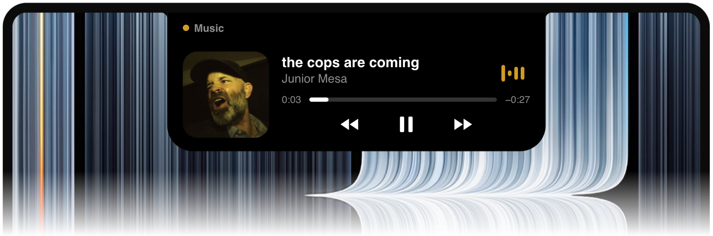
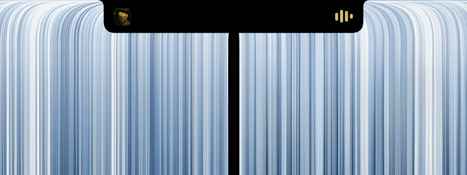

<p align="center"></p>

<h1 align="center">Brim</h1>

<p align="center">A notch island for macOS.<br>Native, light on battery, no CPU at rest.</p>

<p align="center"><a href="https://andrespaladino.github.io/brim/">Website</a> · <a href="../../releases/latest">Download</a> · <a href="#build">Build from source</a></p>

<p align="center"></p>

<p align="center"><br><sub>Artwork next to the notch. Hover to open the player.</sub></p>

<p align="center"><br><sub>Volume and brightness, without the macOS indicator.</sub></p>

<p align="center"><br><sub>AirPods and other audio devices, with battery.</sub></p>

<p align="center"><br><sub>Little friends up there.</sub></p>

<p align="center"><sub>And more.</sub></p>

## Why

Brim is written in Swift with AppKit and SwiftUI. It only wakes up when macOS reports a change, and never polls. At rest it uses no CPU and about 25 MB of memory.

## Install

Download the `.dmg` from [Releases](../../releases/latest) and drag Brim to Applications.

Brim isn't notarized, so macOS blocks it the first time. Open System Settings, go to Privacy & Security and click Open Anyway.

Requires macOS 15 or later. Tested on macOS 27 on a MacBook Air M4.

Brim asks for Accessibility to replace the volume and brightness indicator, and for Bluetooth to read headphone battery. It uses private APIs (MediaRemote, SkyLight, DisplayServices), so a macOS update can break parts of it.

## Build

Needs the Xcode Command Line Tools.

```sh
scripts/make-cert.sh         # once: local signing certificate, keeps permissions between builds
scripts/build.sh --install   # build and copy to /Applications
scripts/dist.sh              # universal .dmg in dist/
```

## License

MIT
